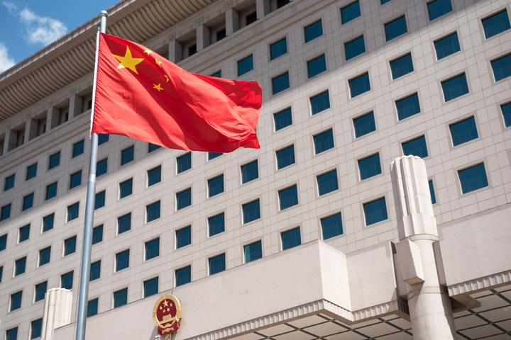

# Wave 10 — No. 1 Wei Fenghe replacement photograph: crop for owner review

Prepared 14 October 2026 for the [18-cover programme #544](https://github.com/VSSpowerlifting/China-Mil-Watch/issues/544). **This is deliberately review-only. No catalogue admission, live page, issue hold or opened-article image changes are authorized.** Stacked after [Wave 9 #560](https://github.com/VSSpowerlifting/China-Mil-Watch/pull/560).

## Original photograph and why it is different from the disqualified asset

- **Source:** [Commons file: 2018-06-27 Beijing Ministry of National Defense.jpg](https://commons.wikimedia.org/wiki/File:2018-06-27_Beijing_Ministry_of_National_Defense.jpg), 5,880 × 3,925 JPG, uploaded from the [U.S. Secretary of Defense Flickr account](https://www.flickr.com/photos/secdef/42160945785/). Commons independently reviewed the Flickr **CC BY 2.0** licence in February 2022, and also records U.S. military official-duty **public domain** status. The copyright treatment for future admission should explicitly preserve the originating U.S. government basis and the original Flickr licence label, without suggesting DVIDS endorses IPR.
- **Photographer:** **U.S. Army Sgt. Amber I. Smith**, credited in Commons EXIF/caption; camera Nikon D750, photo record short title **180627-D-SV709-0014**. **This frame is not** the previously noted DVIDS image [#4517865 / VIRIN 180627-D-SV709-0098](https://www.dvidshub.net/image/4517865/us-secretary-of-defense-james-n-mattis-meets-with-chinas-minister-of-national-defense-wei-fenghe). Both were taken by Amber Smith during the same meeting, but their source IDs differ. Do not claim they are identical.
- **Depicted event:** James Mattis meeting then-Chinese Defense Minister **Wei Fenghe** at the PLA's Bayi Building in Beijing in June 2018. Commons' camera metadata dates the image **27 June 2018**; prose caption says **28 June**. Until date/time discrepancy is independently reconciled, publish *June 2018* without a day.
- **Story:** Brief No. 1, *Two Defense Ministers, One Verdict*, for 7–9 May 2026. Photo shows **Wei**, not former Minister **Li Shangfu**, and is **not** a photograph of either minister's 2026 legal proceedings. The old 2012 image of unrelated officers stays disqualified; do not silently reuse or relabel it.
- **Public-domain government provenance:** [Commons author/EXIF and original Flickr posting](https://commons.wikimedia.org/wiki/File:2018-06-27_Beijing_Ministry_of_National_Defense.jpg). DVIDS related-event corroboration is helpful for the identity of the minister, not proof of authorship of this exact frame. Do not assert the DVIDS source has the same camera ID.
- **Expected source fingerprint:** Commons original SHA-1 \`a07e6f412425ca46c7b1a16a1474f57500e5d3fc\`, **3,049,499 bytes**, JPEG 5,880 × 3,925. These must be verified on acquired bytes, not assumed. Never ingest under a mismatched host, size, image format or SHA.
- **Required public source notice if ultimately adopted:** “The appearance of U.S. Department of War (DoW) visual information does not imply or constitute DoW endorsement.” Label any catalogue derivative *cropped/resized by IPR*.

## Owner-only crop proof

The independent preview is intentionally written under \`docs/engineering/photo_review/\`, **not** to \`site/assets/catalogue/\`, the source manifest, catalogue admissions, rendered \`output/\` or Pages. This ensures No.1 remains **held** everywhere it matters. The live site retains its editorial plate.

If the preview has been generated by the controlled source-acquisition workflow, the actual files and cryptographic checks are:

- Original: \`docs/engineering/photo_review/no-01-wei-fenghe-2018-original.jpg\` SHA-256 \`31f65b10bd45ae2ba70e09019f8f8164367ec1ddc7f03fb111b988ac35c07a51\`.
- Candidate card: \`docs/engineering/photo_review/no-01-wei-fenghe-2018-card.jpg\` SHA-256 \`dbdf4dc77728116b977dce9d05b3ed6d1ab9c38dd8c56126481e44e4bf2b586a\`, 720 × 480; **not admitted or published**.
- Commons SHA-1 \`a07e6f412425ca46c7b1a16a1474f57500e5d3fc\`; full-sized original verified against live MediaWiki imageinfo and exact downloaded bytes.

**Proposed eventual caption:** “Then-Chinese defence minister Wei Fenghe during a meeting with U.S. defence secretary James Mattis in Beijing, June 2018. Historical portrait/context only; Li Shangfu is not shown, and this is not a photograph of their May 2026 sentencing.”

**Proposed alt:** “Then-Chinese defence minister Wei Fenghe and U.S. defence secretary James Mattis during a June 2018 meeting in Beijing.” This identification follows the originating official caption and requires a final visual crop check. If the crop does not show both people clearly, make the alt more modest.

**Go/no-go:** User explicitly accepts the replacement photo and final crop, original subject identity remains unambiguous, Commons rights and original SHA-1 check pass, required notice appears on the card, and exact-head full offline and browser QA pass after a separate admission change. Do **not** equate a research asset in this folder with acceptance. Retain the old No.1 held admission until that decision; Nos.10 (held) and 12 (denied) stay unchanged.

