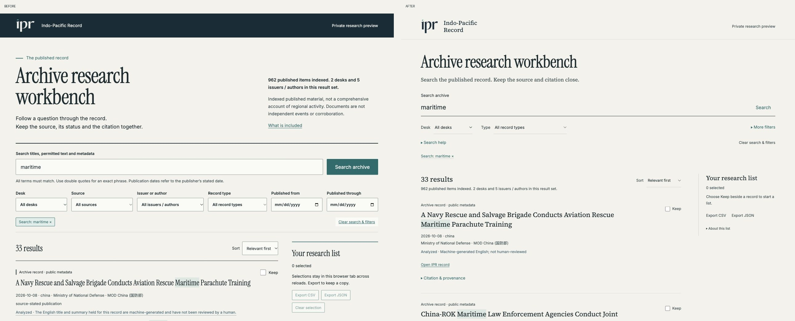
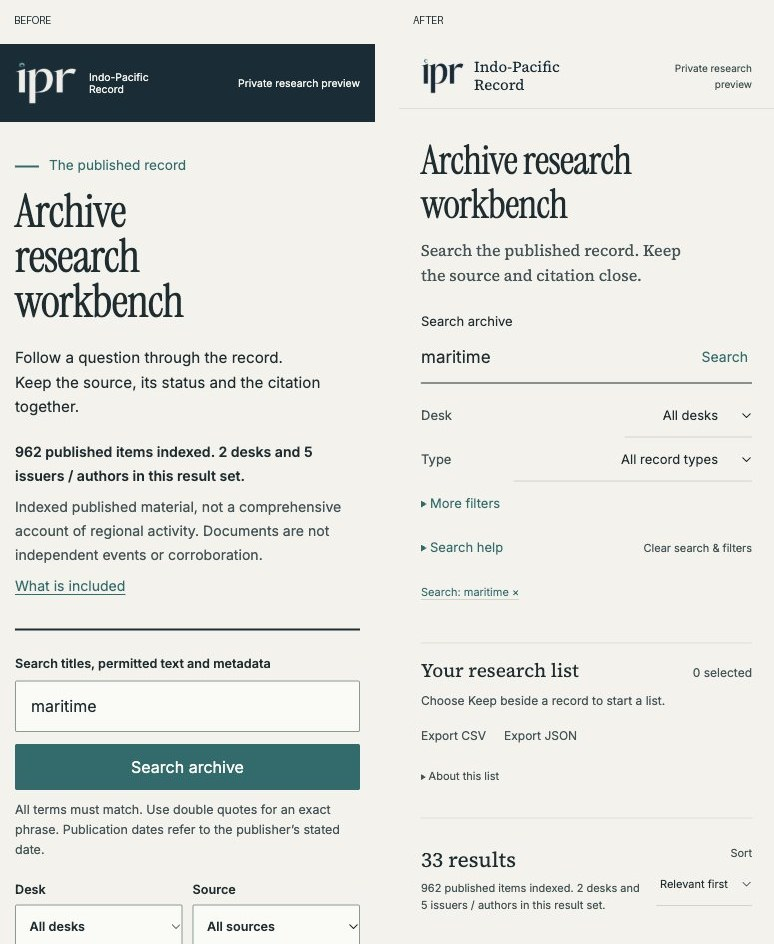

# Workbench visual revision — PR #766

Private preview only. The comparable captures use the same public corpus,
`?q=maritime&sort=relevance`, an empty research list, collapsed help, and scroll
position zero. Desktop is 1280 × 1000; mobile is 375 × 900. Before is committed
head `5079ed99c128fb9e1fc85f2d7d5d16ea3b4bc287`; after is this revision.
The original interface did load Inter; its heavy control weights and block layout
contributed to the generic appearance. The revision uses regular Inter with
Source Serif 4 reading titles and Instrument Serif selectively in the heading.

Additional actual Chromium captures:

- [Expanded filters, desktop](expanded-filters-desktop.jpg) and [mobile](expanded-filters-mobile.jpg).
- [Selected record, full citation and exports, desktop](selected-citation-desktop.jpg) and [mobile](selected-citation-mobile.jpg).
- [Empty results with a persistent selection, mobile](empty-results-mobile.jpg).
- [Actual rendered-font and successful local response evidence](font-proof.json).

Production typography was inspected on the live IPR archive and against
`docs/DESIGN_SYSTEM.md`, `site/preview/fonts.css` and existing local font/logo
assets. CDP reports custom glyphs from InstrumentSerif-Regular, SourceSerif4-Regular
and Inter-Regular, with successful HTTP 200 responses for the corresponding local
WOFF2 files. Controls and metadata compute to Inter at weight 400. No new asset,
font service, package, shared stylesheet or production template was introduced.

Validation: 36 focused behavior/browser tests pass. Tests exercise font file
identity and actual rendered custom glyphs; native disclosure keyboard access,
hidden-filter URL restore/removal/focus; 320/375/768/1280 px overflow; full raw
provenance and exact citation/export preservation. Existing end-to-end tests
cover copy, CSV/JSON downloads, selection persistence, back/forward/reset,
malformed input, HTML payloads and private-server boundaries. Manual desktop/mobile
inspection covers long titles, expanded filters, empty results, selected items,
citation panels and export controls. No browser warning/error logs observed.
Core text/ground contrast pairs remain above 4.5:1; focus outlines and 44 px action
heights remain visible. This is not a complete assistive-technology audit.

The 962-item corpus digest remains
`c8cdc7fbe12485fd948e33036892d90c2c74c95f45975386803f0c799284d7b9`.
All 1,832 tracked DB/output/Brief files plus the four unchanged corpus/query/server
source files retain their initial hashes (1,836 total). No generated production or
editorial content changed. The output validator retains its 10 governed warnings.
Exact-head full offline CI and any environmental limitations are recorded in the PR.
No merge, production integration or deployment is authorized.
